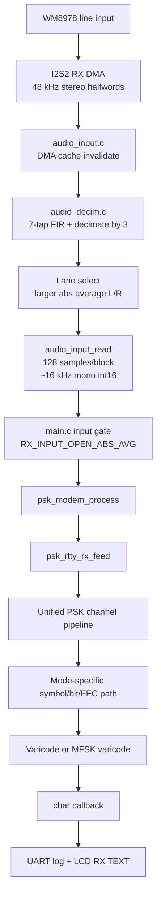
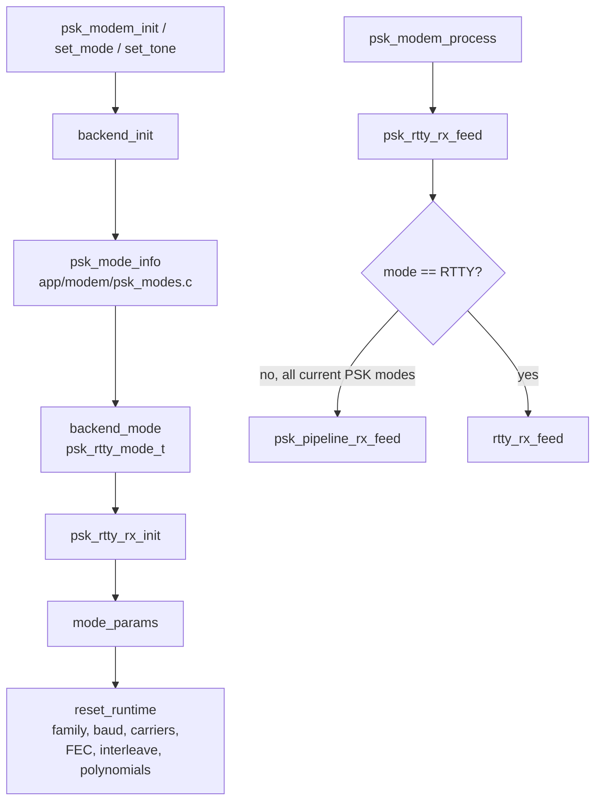
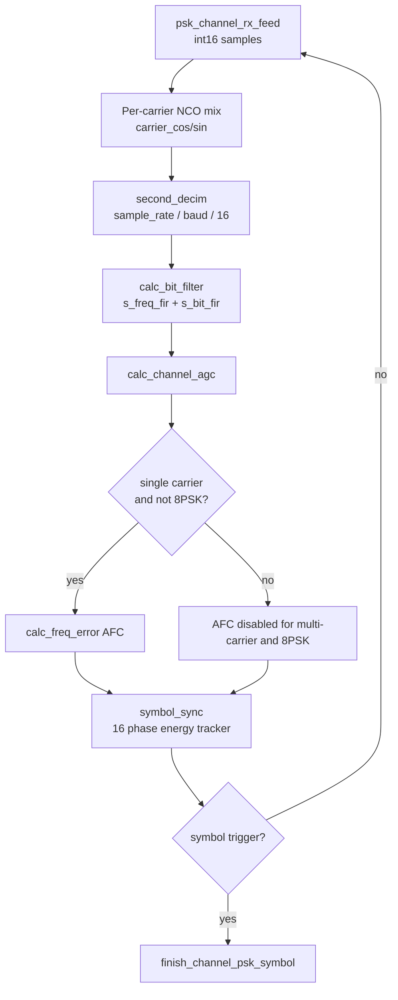
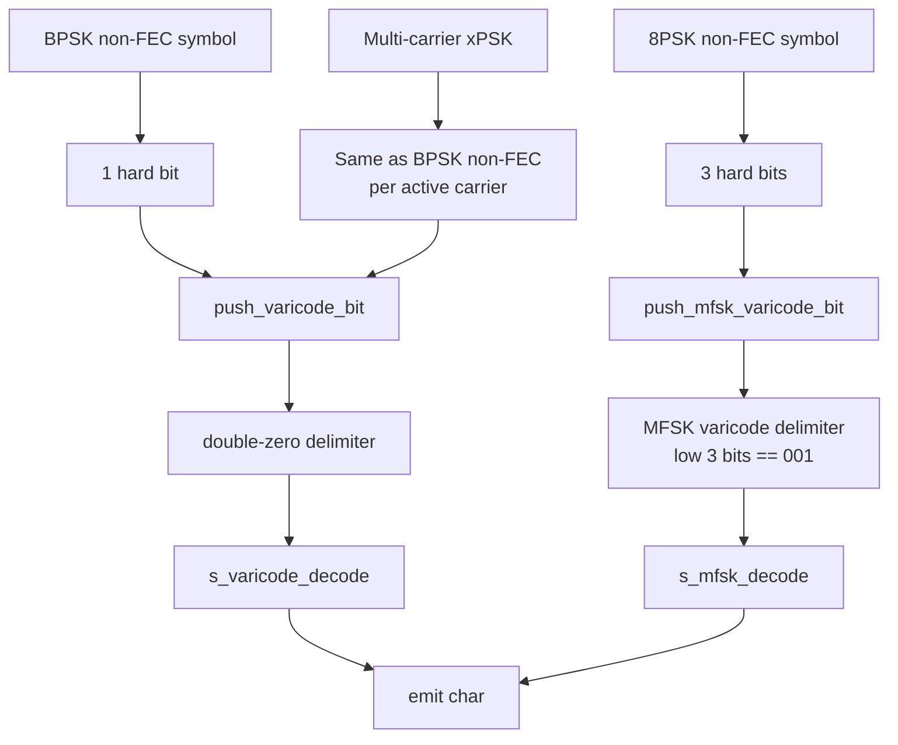
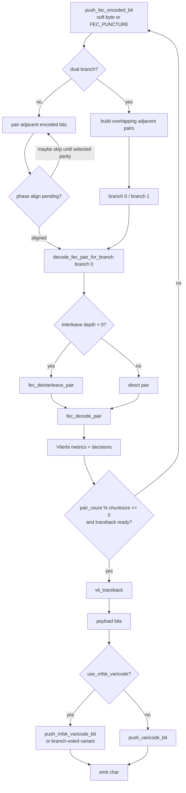

# PSK Decode Architecture

This document describes the PSK receive path implemented in the current firmware.
It follows the actual code paths in:

- `Core/Src/main.c`
- `app/platform/audio_input.c`
- `app/modem/psk_modem.c`
- `app/modem/psk_modes.c`
- `third_party/psk_rtty/psk_rtty.c`

RTTY support exists in `third_party/psk_rtty`, but this document focuses on the PSK modes registered in `app/modem/psk_modes.c`.

## Top-Level Receive Path



The board audio codec is requested at 48 kHz. On the current H743 clock tree, I2S2 is derived from PLL1Q = 200 MHz, so the actual codec rate is treated as about 48828 Hz and the decoder receives `AUDIO_INPUT_ACTUAL_DECODE_RATE_HZ`.

## Modem Front Door



All 27 registered PSK modes have `decode_supported = 1` and enter the same backend file, `third_party/psk_rtty/psk_rtty.c`.

## Unified PSK Channel Pipeline

All BPSK, QPSK, 8PSK, FEC, and multi-carrier xPSK modes share this front-end:



Important behavior:

- Multi-carrier modes use one NCO/filter state per carrier.
- AFC is only active for single-carrier BPSK/QPSK paths, not for 8PSK or multi-carrier modes.
- `symbol_sync()` chooses timing from filtered channel energy and triggers `finish_channel_psk_symbol()`.
- `finish_channel_psk_symbol()` computes differential phase from current and previous per-carrier complex samples.

## Symbol Dispatch

```mermaid
flowchart TD
    A[finish_channel_psk_symbol] --> B[for each active carrier]
    B --> C[differential phase<br>atan2(cross,dot)]
    C --> D[nearest phase distance<br>squelch quality]
    D --> E{PSK family}

    E -- BPSK --> F[inverse_psk_symbol<br>2 states]
    F --> G[process_raw_symbol]

    E -- QPSK --> H[process_qpsk_symbol<br>qpsk_soft_bit x2]
    H --> I[push_fec_encoded_bit]

    E -- 8PSK --> J[inverse_psk_symbol<br>8 states]
    J --> K[process_raw_symbol]

    G --> L{FEC enabled?}
    K --> L
    L -- no --> M[Varicode or MFSK varicode]
    L -- yes --> N[soft/hard encoded bits]
    N --> O[FEC/Viterbi path]

    M --> P[emit chars when squelch stable]
    O --> P
```

## Non-FEC Payload Paths



Non-FEC BPSK and xPSK use normal PSK varicode. Non-FEC 8PSK uses the MFSK-style varicode decoder.

## FEC/Viterbi Path



FEC parameters are selected in `mode_params()`:

| Family/mode group | FEC K | Polynomials | Interleave | Puncture | Output text code |
| --- | ---: | --- | ---: | --- | --- |
| BPSK63F | 7 | `0x6d`, `0x4f` | 0 | no | MFSK varicode |
| QPSK31/63/125/250/500 | 5 | `0x17`, `0x19` | 0 | no | PSK varicode |
| 8PSK125F | 16 | `0152711`, `0126723` | 384 | no | MFSK varicode |
| 8PSK250F | 16 | `0152711`, `0126723` | 512 | no | MFSK varicode |
| 8PSK500F | 13 | `016461`, `012767` | 640 | yes | MFSK varicode |
| 8PSK1000F/1200F | 7 | `0x6d`, `0x4f` | 512 | yes | MFSK varicode |

Special FEC behavior:

- `BPSK63F` and `8PSK125F` use dual adjacent-bit branches.
- `8PSK250F` uses phase search but not dual branch.
- Punctured 8PSK-FEC modes call `push_8psk_soft_bits()` and then insert an additional `FEC_PUNCTURE`.
- `FEC_PUNCTURE` is encoded as `128` and ignored by branch metric scoring.

## Mode-To-Path Matrix

| Mode | Family | Baud | Carriers | Bits/sym | FEC | Path |
| --- | --- | ---: | ---: | ---: | --- | --- |
| BPSK31 | BPSK | 31.25 | 1 | 1 | no | Unified PSK front-end -> BPSK differential symbol -> hard bit -> PSK varicode |
| BPSK63 | BPSK | 62.5 | 1 | 1 | no | Unified PSK front-end -> BPSK differential symbol -> hard bit -> PSK varicode |
| BPSK63F | BPSK | 62.5 | 1 | 1 | yes K=7 | Unified PSK front-end -> BPSK soft bit -> dual-branch FEC/Viterbi -> MFSK varicode |
| BPSK125 | BPSK | 125 | 1 | 1 | no | Unified PSK front-end -> BPSK differential symbol -> hard bit -> PSK varicode |
| BPSK250 | BPSK | 250 | 1 | 1 | no | Unified PSK front-end -> BPSK differential symbol -> hard bit -> PSK varicode |
| BPSK500 | BPSK | 500 | 1 | 1 | no | Unified PSK front-end -> BPSK differential symbol -> hard bit -> PSK varicode |
| BPSK1000 | BPSK | 1000 | 1 | 1 | no | Unified PSK front-end -> BPSK differential symbol -> hard bit -> PSK varicode |
| 12xPSK125 | BPSK/xPSK | 125 | 12 | 1 | no | Unified multi-carrier front-end -> per-carrier BPSK hard bit -> PSK varicode |
| 6xPSK250 | BPSK/xPSK | 250 | 6 | 1 | no | Unified multi-carrier front-end -> per-carrier BPSK hard bit -> PSK varicode |
| 2xPSK500 | BPSK/xPSK | 500 | 2 | 1 | no | Unified multi-carrier front-end -> per-carrier BPSK hard bit -> PSK varicode |
| 4xPSK500 | BPSK/xPSK | 500 | 4 | 1 | no | Unified multi-carrier front-end -> per-carrier BPSK hard bit -> PSK varicode |
| 2xPSK800 | BPSK/xPSK | 800 | 2 | 1 | no | Unified multi-carrier front-end -> per-carrier BPSK hard bit -> PSK varicode |
| 2xPSK1000 | BPSK/xPSK | 1000 | 2 | 1 | no | Unified multi-carrier front-end -> per-carrier BPSK hard bit -> PSK varicode |
| QPSK31 | QPSK | 31.25 | 1 | 2 | yes K=5 | Unified PSK front-end -> QPSK soft bits -> FEC/Viterbi -> PSK varicode |
| QPSK63 | QPSK | 62.5 | 1 | 2 | yes K=5 | Unified PSK front-end -> QPSK soft bits -> FEC/Viterbi -> PSK varicode |
| QPSK125 | QPSK | 125 | 1 | 2 | yes K=5 | Unified PSK front-end -> QPSK soft bits -> FEC/Viterbi -> PSK varicode |
| QPSK250 | QPSK | 250 | 1 | 2 | yes K=5 | Unified PSK front-end -> QPSK soft bits -> FEC/Viterbi -> PSK varicode |
| QPSK500 | QPSK | 500 | 1 | 2 | yes K=5 | Unified PSK front-end -> QPSK soft bits -> FEC/Viterbi -> PSK varicode |
| 8PSK125 | 8PSK | 125 | 1 | 3 | no | Unified PSK front-end -> 8PSK differential symbol -> 3 hard bits -> MFSK varicode |
| 8PSK250 | 8PSK | 250 | 1 | 3 | no | Unified PSK front-end -> 8PSK differential symbol -> 3 hard bits -> MFSK varicode |
| 8PSK500 | 8PSK | 500 | 1 | 3 | no | Unified PSK front-end -> 8PSK differential symbol -> 3 hard bits -> MFSK varicode |
| 8PSK1000 | 8PSK | 1000 | 1 | 3 | no | Unified PSK front-end -> 8PSK differential symbol -> 3 hard bits -> MFSK varicode |
| 8PSK125F | 8PSK | 125 | 1 | 3 | yes K=16 | Unified PSK front-end -> 8PSK soft bits -> dual-branch interleaved FEC/Viterbi -> MFSK varicode |
| 8PSK250F | 8PSK | 250 | 1 | 3 | yes K=16 | Unified PSK front-end -> 8PSK soft bits -> phase-search interleaved FEC/Viterbi -> MFSK varicode |
| 8PSK500F | 8PSK | 500 | 1 | 3 | yes K=13 punctured | Unified PSK front-end -> 8PSK soft bits + puncture -> interleaved FEC/Viterbi -> MFSK varicode |
| 8PSK1000F | 8PSK | 1000 | 1 | 3 | yes K=7 punctured | Unified PSK front-end -> 8PSK soft bits + puncture -> interleaved FEC/Viterbi -> MFSK varicode |
| 8PSK1200F | 8PSK | 16000/13 | 1 | 3 | yes K=7 punctured | Unified PSK front-end -> 8PSK soft bits + puncture -> interleaved FEC/Viterbi -> MFSK varicode |

## Module Responsibilities

| Module | Responsibility |
| --- | --- |
| `app/platform/audio_input.c` | Codec/I2S/DMA board path, stereo capture, cache maintenance, decimation, lane selection, block queue |
| `app/platform/audio_decim.c` | Shared FIR + decimate-by-3 frontend used by board and host tooling |
| `Core/Src/main.c` | Reads audio blocks, applies input gate, calls modem process, logs diagnostics, updates display |
| `app/modem/psk_modes.c` | User-visible mode registry and mapping to backend `psk_rtty_mode_t` |
| `app/modem/psk_modem.c` | Thin modem facade, mode/tone/AFC/squelch control, char callback bridge |
| `third_party/psk_rtty/psk_rtty.c` | Unified PSK channel frontend, symbol recovery, squelch, varicode, MFSK varicode, FEC/Viterbi |
| `app/dsp/spectrum.c` | UI spectrum/waterfall analysis only; it is not in the decode path |
| `app/ui/display.c` | UI rendering and touch-mode hit testing; it is not in the decode decision path |

## Memory-Heavy Decode State

The K=16 FEC paths use large static Viterbi workspaces:

- Decision rows: `s_vit_decisions0`, `s_vit_decisions1`
- Metric buffers: `s_vit_metrics*_a`, `s_vit_metrics*_b`
- Traceback and interleave tables per branch
- `s_vit_out_pair` transition-output table

On the STM32 build these are split across DTCM, D1, D2, and D3 linker sections through:

- `.dtcm_bss`
- `.ram_d2_bss`
- `.ram_d3_bss`

This split is part of the real-time architecture: hot tables and metrics should stay in fast internal RAM; SDRAM should be treated as display/UI storage, not as a place for audio or Viterbi hot data.
